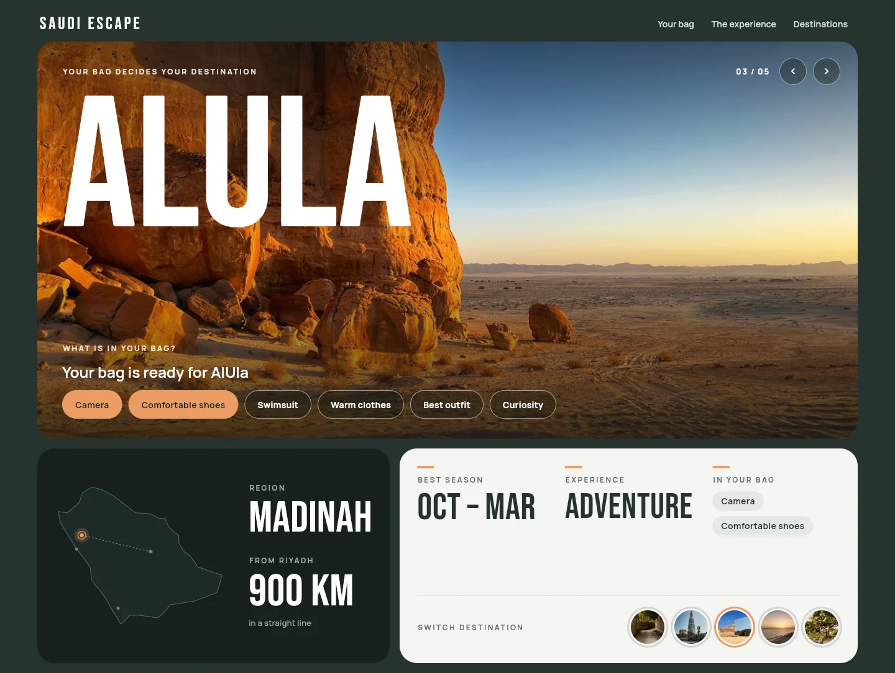
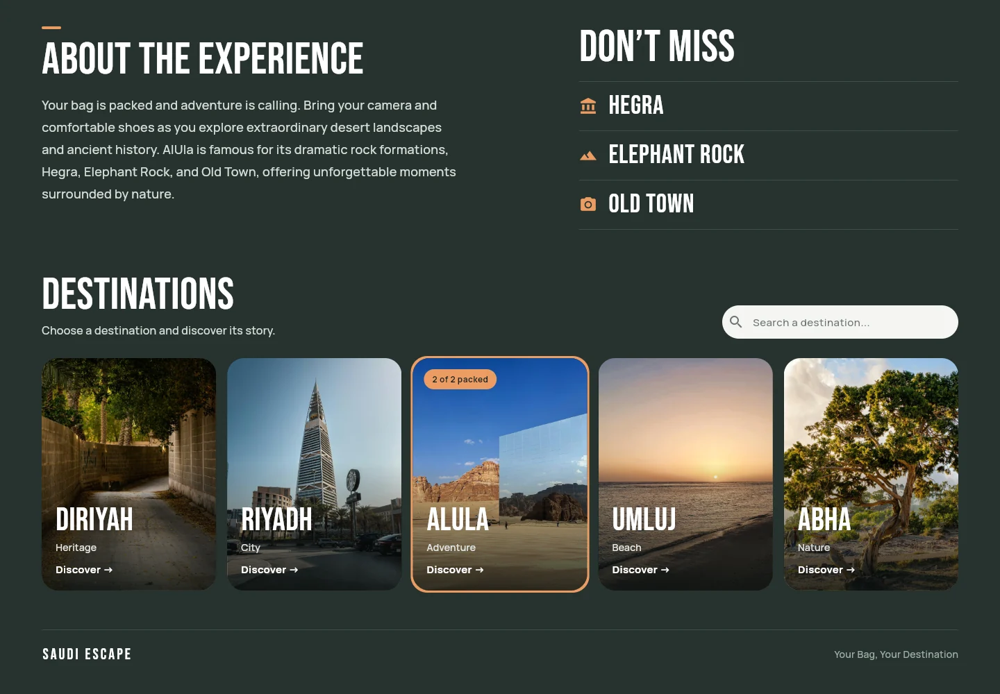
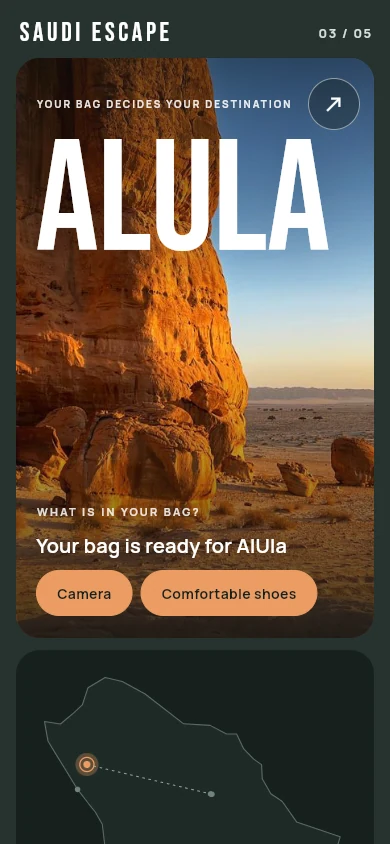
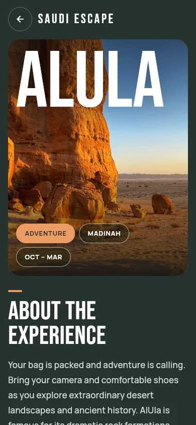

# Saudi Escape: Your Bag, Your Destination

A Flutter app that lets your bag decide where in Saudi Arabia you travel. Tick what you packed, and the app points you to the destination that fits: AlUla for a camera and comfortable shoes, Umluj for a swimsuit, Abha for warm clothes.

A Flutter project with web, Android and Windows targets. Destinations are loaded from Supabase.

<p align="center">
  
</p>

<p align="center">
  
</p>

<p align="center">
  
  &nbsp;&nbsp;
  
</p>

## How it works

Under the photo, **What is in your bag?** lists six things you can tick. Each one belongs to a destination, and the stage switches to the destination with the most ticked items.

| In your bag | Destination |
| --- | --- |
| Camera, Comfortable shoes | AlUla |
| Swimsuit | Umluj |
| Warm clothes | Abha |
| Best outfit | Riyadh |
| Curiosity | Diriyah |

The line above the chips says what is still missing, for example *Pack camera + comfortable shoes for AlUla*, or *Your bag is ready for AlUla* once everything is packed.

## Features

- **Stage:** a large photo with the destination's name, a counter and previous / next buttons. Photos cross-fade when you switch.
- **Facts:** a line map of Saudi Arabia that marks the destination and its route from Riyadh, plus region, distance, best season and type of experience.
- **Story:** *About the experience* and *Don't miss* for each destination.
- **Destinations:** search, and a card for each destination that shows how many of its items are in your bag.
- **Responsive:** a wide layout on desktop and tablet; on phones the card opens a detail screen.
- **Reliable loading:** the destinations load once; if the request fails there is a message and a *Try again* button.
- **Accessible:** buttons have labels, the map has a text description, and the map's pulse stops when the system's reduce-motion setting is on.

## Run it

You need a Flutter beta that ships Dart 3.14 or newer (the project requires `^3.14.0-95.2.beta`).

```bash
git clone https://github.com/Rehamalkhamees/project-travel
cd project-travel
cp .env.example .env      # then put your Supabase URL and key in .env
flutter pub get
flutter run -d chrome
```

### Try it without Supabase

The app can run on the sample destinations that ship with it. `.env` must still exist, but its values can stay as placeholders.

```bash
cp .env.example .env
flutter run -d chrome --dart-define=OFFLINE_DEMO=true
```

### Supabase table

The app reads a table called `destinationData` with these columns:

| Column | Example | Notes |
| --- | --- | --- |
| `name` | `AlUla` | Must be one of `Diriyah`, `Riyadh`, `AlUla`, `Umluj`, `Abha`: the hero photo, map position, texts and bag items are looked up by name. |
| `type` | `Adventure` | Shown as the destination's experience. |
| `image` | `assets/images/alula2.jpeg` | The card photo, a path inside `assets/images/`. |
| `color` | `0xFFEB9C63` | The destination's accent colour as an ARGB number. |

## Tests

```bash
flutter test
```

They cover the bag matching, ticking chips on the home page, search, the retry button, and that the phone layout builds without overflow.

## Project structure

```
lib/
  main.dart                      start-up (loads .env, connects to Supabase)
  config.dart                    the OFFLINE_DEMO switch
  models/destination_model.dart  a row of destinationData
  service/database.dart          reads the table
  data/
    bag.dart                     bag items and the matching rules
    destination_content.dart     region, season, distance, texts and map position per destination
    demo_destinations.dart       sample rows for the offline demo and tests
  pages/                         home page and the phone detail screen
  widgets/                       stage, map, panels, story, cards
  ui/style.dart                  colours, text styles, breakpoints
assets/
  images/                        destination photos
  fonts/                         Bebas Neue and Manrope (SIL Open Font License)
docs/screenshots/                the images in this README
```

To change a destination's season, region or texts, edit `lib/data/destination_content.dart`. Distances are straight-line estimates from Riyadh, and the map is a simplified outline.
